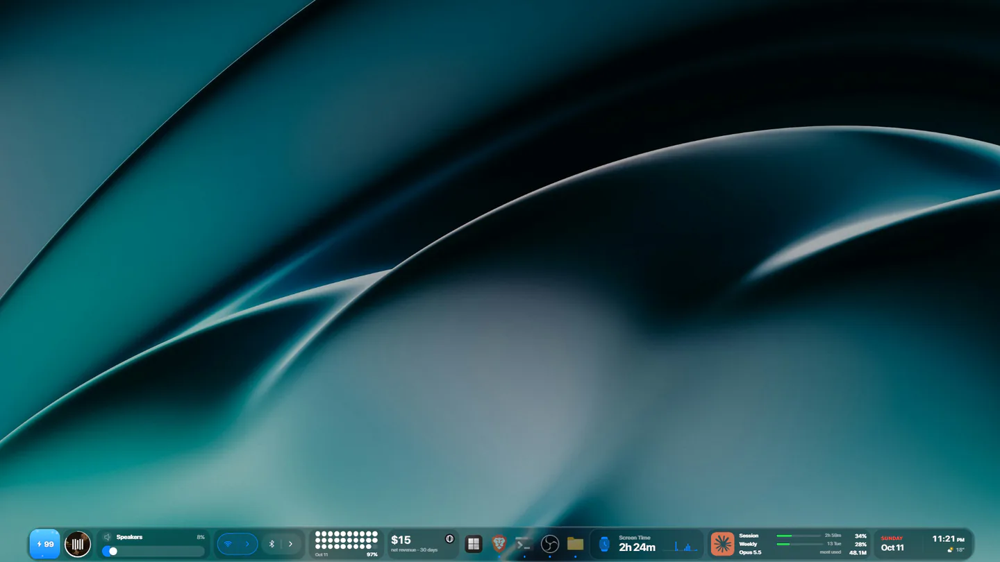
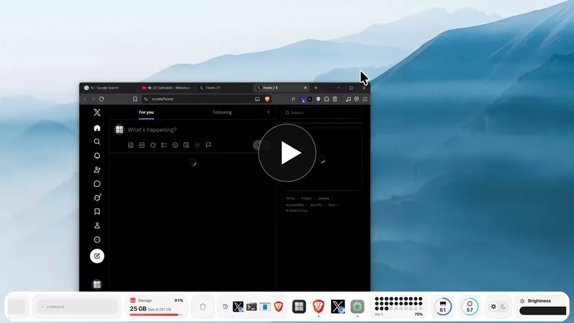
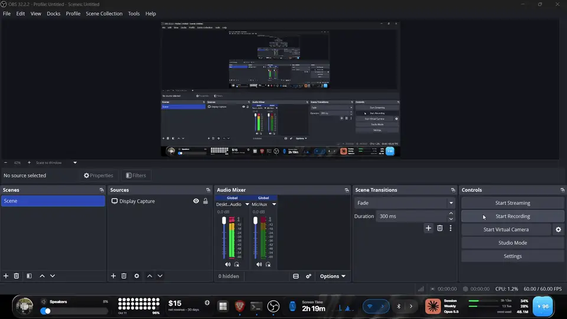
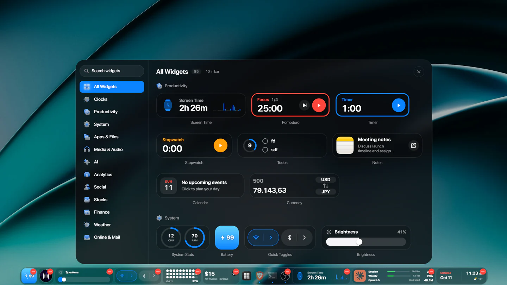
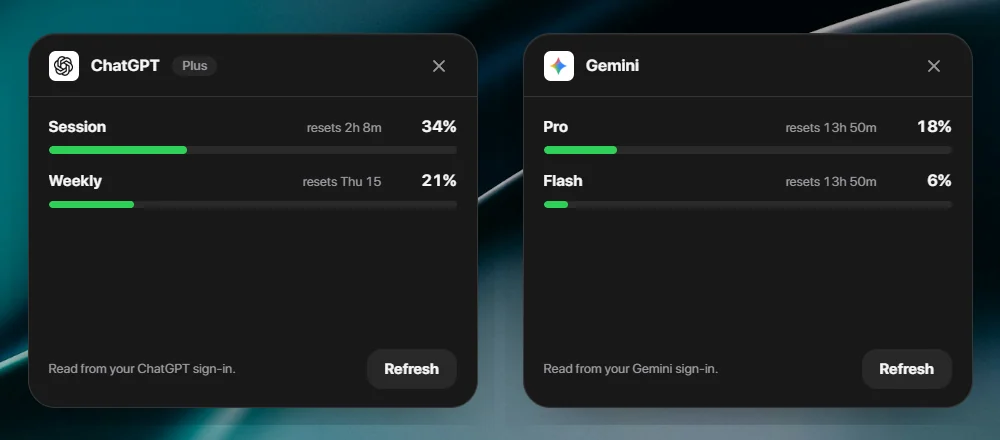
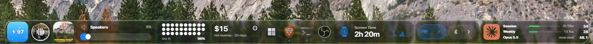
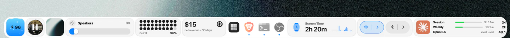
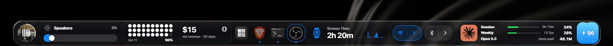

# lumabar: a taskbar alternative for Windows 11 and 10

**lumabar replaces the Windows taskbar with one live widget dock.** Your apps and 85 widgets sit on the top or bottom edge of the screen: music, calendar, weather, system stats, screen time, and even your Claude and ChatGPT usage limits.

[Website](https://lumabar.xyz) · [All widgets](https://lumabar.xyz/widgets) · [Guides](https://lumabar.xyz/guides) · [Docs](https://lumabar.xyz/docs) · [Changelog](https://lumabar.xyz/changelog)

## See it in action

**Liquid Glass, live:** the dock bends whatever moves behind it, frame by frame. When nothing behind it changes, the glass rests and uses no work. [More about the glass](https://lumabar.xyz/guides/liquid-glass-windows).

## What lumabar is

lumabar is a desktop app for Windows 11 and Windows 10. It puts one bar on the edge of your screen that holds your apps and live widgets, so the things you check all day are a glance away instead of an app away. While lumabar is open, the Windows taskbar auto-hides (or hides completely, your choice). lumabar never modifies Windows: close it and the taskbar is back as it was.

- **Your apps:** the apps pinned to your Windows taskbar, plus every open window.
- **85 widgets** in 12 groups: Clocks, Productivity, System, Apps & Files, Media & Audio, AI, Analytics, Social, Stocks, Finance, Weather, and Online & Mail.
- **Top or bottom edge:** drag the dock to the top of the screen and it snaps there. This works on Windows 10 and every Windows 11 build.
- **No setup files:** right-click the dock, choose Widgets…, and drag a tile into place. There are no skins to install and no config files to edit.
- **Out of the way:** the dock steps aside when a fullscreen game or video covers its display.

## Widgets

A few of them:

- **Media:** now playing with controls, and volume.
- **Productivity:** todos, notes, calendar, pomodoro, and a stopwatch.
- **Screen Time:** today's total, hour by hour, and every app and site, kept on your PC.
- **System:** CPU, RAM and network charts, CPU temperature, battery, brightness, and quick toggles.
- **Clocks and weather:** digital, flip, and analog clocks, world clocks, and the forecast.
- **AI usage limits:** your plan limits for Claude, ChatGPT, Gemini, Grok, DeepSeek, and GLM, live in the dock.
- **Founders and developers:** revenue from Stripe, Polar, and Dodo, plus GitHub, Gmail, and stocks.

The full list, with a picture of every tile: [lumabar.xyz/widgets](https://lumabar.xyz/widgets).

## Five styles

Black, White, Liquid Glass, iOS Glass, and Midnight, in three sizes.

## Privacy

There is no account, no lumabar server, and no telemetry. Your layout, todos, and notes stay on your PC. Only the license check and the widgets you turn on go online, and each one talks straight to its own service. The AI widgets read your own sign-in with that service, read-only.

## Requirements

- Windows 11 or Windows 10, 64-bit or 32-bit
- No administrator rights needed

## Get lumabar

lumabar is a one-time purchase with no subscription, and every update is included. It has a 14-day money-back guarantee. Buy it at **[lumabar.xyz](https://lumabar.xyz)**, then install the MSI for your Windows version.

## This repository

This repository holds lumabar's release builds. Installed copies of lumabar update themselves from the latest release here (`latest.json`). Every installer is signed with the lumabar updater key, and the app refuses any installer that isn't. lumabar is commercial software, and its source code is not public.

## Compared with other tools

- [lumabar vs Seelen UI](https://lumabar.xyz/guides/lumabar-vs-seelen-ui)
- [lumabar vs MyDockFinder](https://lumabar.xyz/guides/lumabar-vs-mydockfinder)
- [A Rainmeter alternative without skins](https://lumabar.xyz/guides/rainmeter-alternative)
- [A Mac-style menu bar for Windows](https://lumabar.xyz/guides/mac-menu-bar-for-windows)
- [Claude usage limits on your desktop](https://lumabar.xyz/guides/ai-usage-limits-on-desktop)

## Contact

Questions, refunds, and license help: [hello@lumabar.xyz](mailto:hello@lumabar.xyz). Feedback is also in the dock's Settings. News: [@lumabar_xyz on X](https://x.com/lumabar_xyz).
